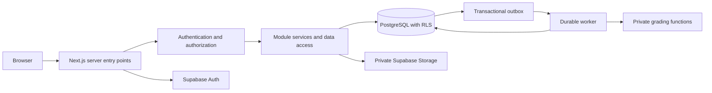

# Architecture

Status: authentication, companies/jobs, candidate/CV/application tracking, core recruiting stages/notes, assessment authoring and secure execution/grading implemented, 2026-10-28. See README.md and the workflow documents for current boundaries. Production operations and remaining modules are proposed.

## Repository inspection

Administration/reliability modules now provide narrow MFA-gated platform operations, independent moderation, scoped analytics/review queues and append-only audit views. [Optional notification delivery](administration-reliability.md) uses a private leased queue and isolated service worker; normal web operations remain user-scoped. Public discovery uses keyset pagination; management pages are bounded. Database quotas complement required upstream traffic controls. See the [deployment gates](production-deployment-checklist.md) for live-stack and operational validation.

The initial workspace was empty, including hidden-file inspection, with no packages, source tree, migration history, Git repository, or inherited instructions. The authentication foundation now includes a package manifest/lockfile, Next.js source, migration, tests and local Supabase configuration. Exact dependency resolution is recorded in package-lock.json. Later modules in this document remain design proposals.

## System shape

The assessment integrity submodule records disclosed browser observations separately from grading evidence. It has bounded authenticated ingestion, heartbeat coordination, append-only events and contextual recruiter reviews. Raw signals never automatically change decisions. See [integrity monitoring](assessment-integrity.md). The optional server-only exam-environment adapter contract lives in a separate future module; no Safe Exam Browser adapter is enabled.

Use a modular monolith: Next.js App Router for web delivery and server entry points; Supabase Auth, PostgreSQL, and Storage for identity and persistence. PostgreSQL functions provide atomic business operations where multiple writes must commit together. Assessment closure runs bounded deterministic grading, result history, shortlisting and in-app notifications in the same transaction. A trusted scheduled SQL/Node worker closes abandoned attempts and retries ungraded closures. See [Assessment execution](assessment-execution.md) for contracts, lock order and scheduling. File scanning is synchronous and fail closed. Optional transactional email uses an isolated leased-queue worker; retention automation and provider bounce handling remain future work. Never rely on work continuing after a serverless HTTP response.



Public browsing is anonymous. Private reads and mutations authenticate and authorize at the server boundary and again through database policies. The browser may use Supabase Auth, but business data access goes through server services. Database grants remain restrictive because the Data API can be called directly.

## Module ownership

| Module | Owns | Contracts exposed to other modules |
| --- | --- | --- |
| Identity | Auth integration, account settings, identity context | requireUser, account status |
| Organizations | Organizations, memberships, invitations | requireOrgPermission, membership lookup |
| Profiles | Candidate public profile, private contact details, experience, education, skills | Public profile DTO, consented application snapshot |
| Companies | Public company presentation | Published company DTO |
| Jobs | Drafts, publishing, discovery, saved jobs | Published job DTO, application eligibility |
| Applications | Applications, pipeline, assignments, notes, stage history | Apply, transition, withdraw, authorized applicant view |
| Assessments | Authoring, immutable versions, invitations, attempts, responses | Start, save response, submit, sanitized attempt DTO |
| Grading | Answer keys, deterministic graders, scores, shortlist evaluations | Grade submitted attempt, evaluate versioned rule |
| Documents | CV metadata, upload lifecycle, access grants | Upload intent, scan status, authorized download |
| Administration | Verification, suspension, moderation, scoped platform roles | Verify organization, suspend, privileged review |
| Audit | Append-only security/business events | Transactional audit append |
| Notifications | Delivery records and retries | Enqueue through outbox |

Modules own writes to their tables. Other modules call explicit services rather than importing internal repositories. Shared code contains infrastructure and primitives, not a growing collection of business helpers. Keep grading replaceable through a versioned grader interface; do not introduce microservices until operational evidence justifies them.

## Proposed folder structure

Create these directories incrementally with working code, rather than empty scaffolding now.

```text
src/
  app/
    (public)/jobs/                 # /jobs and /jobs/[slug]
    (public)/companies/[slug]/
    (public)/candidates/[slug]/
    (auth)/                       # /login, /signup, /auth/callback
    (candidate)/candidate/        # profile, applications, assessments
    (organization)/org/[orgId]/   # dashboard, jobs, applicants, team
    (platform)/admin/             # verification and moderation
    api/                         # webhooks, upload/download, worker ingress
    layout.tsx
    globals.css
  modules/
    <module>/
      schemas.ts                 # Zod input and explicit DTO schemas
      types.ts
      components/                # module UI
      server/
        actions.ts               # thin Server Action adapters
        service.ts               # business authorization and orchestration
        repository.ts            # scoped persistence
        queries.ts               # minimal read projections
  components/ui/                 # shadcn/ui primitives
  lib/
    auth/                        # authenticated identity and permission context
    supabase/{browser,server}.ts
    env/                         # distinct public and server env schemas
    errors/
    observability/
  server/
    admin-client.ts              # server-only, exceptional privileged operations
    outbox/
  types/database.ts              # generated from migrations
  proxy.ts                       # session refresh; never sole authorization
workers/
  grading/
  documents/
  notifications/
supabase/
  migrations/
  tests/                         # SQL policies, functions, integrity
  seed.sql                       # synthetic local data only
tests/{integration,e2e}/
docs/
```

Route groups do not protect routes. Organization IDs in URLs select context; they do not confer permission. Avoid overlapping route paths between groups.

## Request and trust boundaries

Every action/handler validates unknown input with Zod, verifies identity, checks current account and membership state, enforces capability and resource ownership, then calls its service. Use request-scoped user clients with RLS. Server Components call query services directly; avoid HTTP calls back into the same application. Return explicit DTOs, never raw rows containing private columns.

Mark server modules with `import 'server-only'`. Use Server Components by default and Client Components only for interaction. Keep authenticated responses private and uncached; explicitly opt public listings into caching with invalidation on publication changes. Do not cache tenant context or authenticated Supabase clients across requests.

Membership, job status, verification status, and assessment timing are checked inside atomic writes to avoid time-of-check/time-of-use gaps. Privileged workers accept identifiers, load canonical records, and check state themselves; a queue payload never grants authority.

## API baseline and official references

Checked 2026-10-28; recheck after selecting actual versions. The following are API direction, not a dependency lock:

- Follow [Next.js authentication](https://nextjs.org/docs/app/guides/authentication) and [data security](https://nextjs.org/docs/app/guides/data-security): authorize server entry points, centralize data access, minimize data sent to clients.
- Current Next.js uses [proxy.ts](https://nextjs.org/docs/app/api-reference/file-conventions/proxy); use async request APIs such as `await cookies()` and await route params where required by the installed release. Do not start new work from legacy middleware examples.
- Use `@supabase/ssr` browser/server clients per [Supabase SSR guidance](https://supabase.com/docs/guides/auth/server-side/creating-a-client). Use verified claims for identity; use Auth-server user validation where current session revocation matters. Never trust `getSession()` alone for server authorization. Use current cookie `getAll`/`setAll` integration rather than deprecated Auth Helpers.
- Use [Tailwind's current Next.js setup](https://tailwindcss.com/docs/installation/framework-guides/nextjs) and [shadcn/ui installation](https://ui.shadcn.com/docs/installation/next); inspect generated components and maintain accessibility. Do not assume older Tailwind configuration conventions.
- Use [Zod 4](https://zod.dev/v4) when scaffolding, subject to dependency compatibility; validate on the server even if the client shares the schema.

## Operations and evolution

Separate local, staging, and production projects and secrets. Deploy additive migrations before application changes; use expand/backfill/contract for destructive changes. Measure request latency, database query plans, grading backlog, scan failures, and authorization denials without logging application content or CVs. Use correlation IDs and structured error categories. Configure backups, agreed RPO/RTO, and a restore exercise before production. Start with PostgreSQL full-text search and keyset pagination; introduce dedicated search or workers only behind existing module contracts when measured load requires it.
