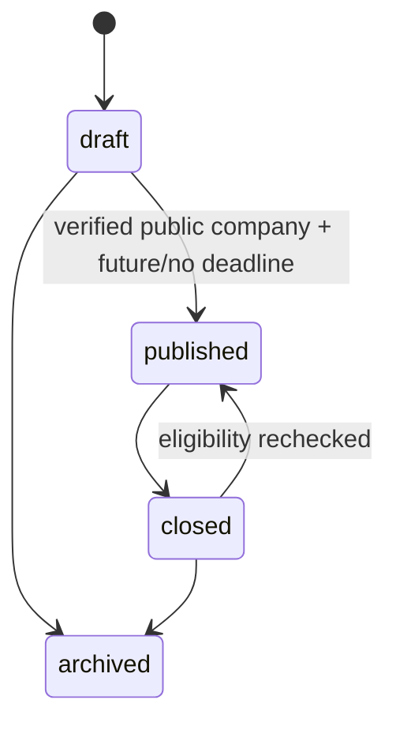

# Companies and jobs

## Current workflows

Owners and administrators edit company details at `/org/{id}/profile`, including a unique lowercase slug, industry, location, HTTPS website, description and desired public visibility. Save the profile before adding images or jobs. `/companies/{slug}` becomes public only when visibility is enabled and the organization is approved and active. Changing the name or website resets verification; those identity fields cannot change while a request is pending.

Submit the legal name, registration number and private review notes at `/org/{id}/verification`. Only owners/admins and MFA-authenticated platform reviewers can read requests. `/admin` supports approve/reject with an audit reason; a reviewer cannot approve an organization they belong to. Requests have one pending row per organization. Decision history cannot be overwritten or replayed.

Recruiter invitations and multiple memberships use the existing team administration flow. Recruiters can create jobs (which assigns them automatically) and manage assigned jobs. Owners/admins can manage every company job and add/remove active recruiter assignments. Private candidate account/profile data remains owner-only; application snapshots share only the name/headline explicitly consented to at submission.

## Jobs

Public discovery also includes a reviewed external Indeed snapshot in `src/modules/jobs/external-catalog.ts`. On 7 November 2026, 13 distinct AJK listings were identified on [Indeed's AJK search page](https://pk.indeed.com/jobs?l=Azad+Kashmir); a duplicate was excluded. Only title, employer, location and source job ID are retained. Individual advertisements could not be fetched for availability verification, so the UI explicitly asks users to confirm availability and requirements on Indeed. This is not an exhaustive or automatically synchronized feed. Entries expire from discovery and detail/application routes on 21 November 2026 unless reviewed and updated.

These global source references do not create tenant-owned employer records, bypass company verification, or enter the Jobwalay application pipeline. Unknown employment types/work arrangements do not satisfy those search filters. External application entry requires authentication/onboarding and shows an explicit handoff to the fixed Indeed job URL without sharing candidate information. Snapshot changes are versioned through Git; no import credentials, paid services or database schema changes are introduced.

`/org/{id}` is the company dashboard, with status filters and bounded pages. Create at `/org/{id}/jobs/new`; edit and manage publication, assignments and received profile-based applications at `/org/{id}/jobs/{jobId}`.

Jobs include title, description, department, location, remote/hybrid/onsite mode, employment type, minimum/maximum experience, education, required skills, optional salary range with currency/period, deadline, number of positions and an optional same-organization published assessment version. Salary values use fixed decimal database columns. Form deadlines are explicitly entered/displayed in Pakistan time (UTC+05:00) and stored as timestamptz.

Allowed transitions:

Archived jobs cannot be edited or reopened. Close a published job before archiving it. Published edits are immediately visible; optimistic version checks reject stale writes instead of overwriting them. All important changes append audit events in the same transaction.

Public discovery at `/jobs` uses PostgreSQL full-text search (including required skills), work-mode/type/location filters and stable cursor pagination. A dedicated anonymous client enforces public RLS even when the visitor is also a hiring manager. Drafts, closed/archived/expired jobs and jobs from hidden/unverified/suspended companies stay out of discovery and direct public detail pages.

The Apply action invokes a real atomic `apply_to_job` operation. It locks the organization/job/account/document and rechecks eligibility after locking. It now requires a clean private CV and stores a complete professional snapshot and application form. Repeated valid submissions return the same active application; closed/expired jobs reject even duplicate retries. Candidates see history on `/candidate`, and authorized hiring staff use the recruitment inbox. See docs/candidate-workflow.md for CVs, stages, notes and withdrawal, and docs/assessment-builder.md for assessment authoring/frozen attempts.

Published assessment versions must belong to the job's organization, enforced by the function and composite FK. The version catalog is now extended by the assessment builder and private key tables. Attaching a version never fabricates an assessment completion or score; response submission/grading remain later delivery work.

## Images and Storage

The `company-assets` bucket is private. The server accepts static PNG/JPEG/WebP files up to 3 MiB and 20 megapixels, fully decodes them with Sharp, strips metadata, resizes and re-encodes to WebP. SVGs and malformed files are rejected. Uploads use random immutable keys below `{organizationId}/{logo|cover}/` and require an owner/admin membership. Database checks prevent referencing another organization's path.

Public reads permit only the currently referenced images of a public/approved company; team members can preview their own company's references. The `/media/company/{orgId}/{kind}` route authorizes both the profile and Storage read, fixes Content-Type to WebP and disables caching/sniffing. There is no client overwrite/delete policy. A soft upload budget of 100 stored assets per company bounds ordinary issuance; a trusted operator should purge unreferenced orphan/replaced objects through the Storage API. Failed metadata commits can leave an unreferenced object; it cannot be read publicly. CVs must use a different private bucket and the separate scanning design.

Server Actions permit 12 MB request bodies for CV support; branding images retain the stricter 3 MiB limit. The company-assets bucket allows only WebP up to 3 MiB. Storage API and browser integration require a configured live Supabase project; embedded SQL fixtures test policy behavior, not the storage service itself.

## Migrations, seeds and checks

Apply the two new migrations after the foundation. `npx supabase db reset` applies all migrations and seeds locally (it discards local database data). Use reviewed `supabase db push` for an existing project; never use the demo seed for production provisioning. Generate client types with `npm run db:types`, or `npm run db:types:embedded` when Docker is unavailable.

`supabase/seed.sql` contains two fictional verified companies, one pending company, a published assessment catalog version, and open/draft/closed/expired/archived jobs. It contains no login accounts, passwords, memberships or platform administrators. Create your own user/organization for the management workflow. Public examples are `/companies/northstar-labs`, `/companies/meadow-studio`, and `/jobs`. Seed data is idempotent and tested twice; deadlines are relative to the first seed execution.

`npm test` applies all migrations to embedded PostgreSQL with actual anon/authenticated roles, exercises cross-user/tenant and assignment policies, lifecycle/version guards, verification privacy/MFA, application eligibility/idempotence/snapshot privacy, storage policies, image decoding and seeds. The fixtures approximate Supabase Auth/Storage schemas; full pgTAP, Auth, Storage and authenticated browser/HTTP checks remain a live-environment validation gate. PGlite serializes statements, so duplicate-submission tests prove idempotence but do not substitute for a multi-connection load/race test.

Official references checked for this implementation: [Supabase RLS](https://supabase.com/docs/guides/database/postgres/row-level-security), [Storage policies](https://supabase.com/docs/guides/storage/security/access-control), [Storage upload](https://supabase.com/docs/reference/javascript/storage-from-upload), [database seeding](https://supabase.com/docs/guides/local-development/seeding-your-database), [Sharp decode limits](https://sharp.pixelplumbing.com/api-constructor/), [Next.js Server Action configuration](https://nextjs.org/docs/app/api-reference/config/next-config-js/serverActions).
