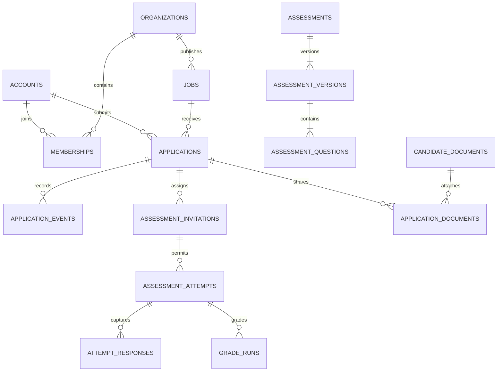

# Database design

Logical schema for the full platform. Migrations implement accounts, private candidate profiles, organizations, memberships, invitations, platform roles, audit events, company profiles/images, verification requests, jobs, job assignments, an assessment version catalog and minimal profile-based applications. Other entities remain proposed. PostgreSQL is the authority for tenant ownership and transitions. See supabase/migrations and docs/company-jobs.md for actual columns, grants and the current subset of workflows.

Migrations 004–005 add professional history, scan-gated candidate_documents, saved_jobs, application snapshots/events/notes, partial active-application uniqueness, bank questions/private keys, approved pools, immutable versions and frozen attempt snapshots. Migrations 006–007 add the execution model below. The later full-platform inventory is a logical proposal where it differs from migrations; generated types and migrations define actual names and constraints.

## Implemented execution model

Migration 008 adds `assessment_integrity_acknowledgements` (immutable versioned receipt), `assessment_monitor_sessions` (mutable bounded document heartbeats), `assessment_integrity_events` (append-only allowlisted observations with server receipt order) and `assessment_monitor_reviews` (append-only authorized context). Tenant/session composite foreign keys, RPC-only writes and scoped RLS apply. These tables do not automatically write grades, flags or application stages. See [monitoring contracts](assessment-integrity.md).

| Relation | Integrity and access |
| --- | --- |
| assessment_invitations | One per application/version; candidate and authorized reviewer reads; SQL-controlled expiry and bounded retake approval |
| assessment_attempts | Frozen version, settings, selected questions, DB times and closure reason; unique candidate/version attempt number and partial unique active attempt |
| assessment_responses | One per attempt/question with optimistic revision; composite tenant/question foreign keys; own reads, validated RPC-only writes |
| private.objective_grade_runs / objective_question_scores | Immutable single objective run per attempt and frozen per-question evidence; no ordinary grants |
| private.manual_question_reviews | Append-only bounded weighted points and rationale with revision; authorized closed-attempt review only |
| private.assessment_integrity_flags / integrity_reviews | Application-wide review holds and audited decisions; no direct candidate disclosure of private evidence |
| assessment_results / assessment_result_history | Current aggregate and immutable revision history; own candidate or current application-review permission; final points/percentage nullable pending written review |
| assessment_appeals | One per attempt, frozen policy/window, audited employer decision; authorized scoped reads |
| user_notifications | Unique user/event key; fixed message kind and application identifiers, own reads, employer permission rechecked |
| private.assessment_engine_errors | Retry diagnostics with SQLSTATE only; trusted operations access |

Applications add `shortlisted` and `shortlist_source_attempt_id`, so later review can pause an automatic shortlist without overwriting a human decision. Engine operations serialize organization → application → attempt, validate deadlines after waiting, and commit grades/history/notifications/stages together. Detailed result keys are available only through a closed-attempt employer RPC. See [execution contracts](assessment-execution.md) for the implemented synchronous grader and scheduler; the outbox/lease model later in this document remains a possible future scaling design.

## Conventions and tenancy

Migrations 009–010 add protected job moderation, RLS-scoped abuse reports, quota counters, revoked Auth-session tombstones, append-only restricted administrative rationales, own-user notification preferences and a private leased email-delivery queue. Indexes cover moderation/verification queues, account directory, recent audit order, application/result joins and pending delivery selection. Platform directory/aggregate RPCs expose minimal projections rather than broad account/candidate grants. See [administration contracts](administration-reliability.md).

Use UUID primary keys, `timestamptz` UTC timestamps and explicit foreign keys. Tenant-owned tables have non-null `organization_id`, including descendants. Each referenced tenant parent has `UNIQUE (organization_id, id)`; children use composite FKs, e.g. `applications(organization_id, job_id) REFERENCES jobs(organization_id, id)`. Forbid tenant reassignment. A matching organization column without the composite FK is insufficient.

Global candidate data belongs to a user, not a tenant. Tenant access is through a particular application or explicit grant; application snapshots cannot confer access to the candidate's whole account. Use database-generated timestamps and check constraints. JSONB is reserved for bounded, versioned payloads, not membership or relationship integrity.

`public` contains RLS-protected API data. A non-exposed `private` schema contains keys, grading internals, platform role assignments, outbox payloads and restricted audit details. Revoke default schema/table/function access; grant only explicit operations. Private-schema placement alone is not authorization.

## Entity inventory

Columns below supplement `id`, `created_at`, and where mutable `updated_at`. Unless specified otherwise, tenant entities include organization_id.

| Table | Important fields and constraints |
| --- | --- |
| accounts | id FK auth.users, status active/suspended/deletion_pending; no user-editable platform role |
| candidate_profiles | user_id unique FK accounts, slug unique, headline, bio, visibility private/public; safe public fields only |
| candidate_contacts | user_id unique, email/phone/preferences; owner-only, shared through explicit application snapshot |
| experiences / education | candidate_id FK, dates, description; end date >= start date |
| skills / candidate_skills | normalized taxonomy; composite PK (candidate_id, skill_id) |
| organizations | slug unique, name, status active/suspended, verification_status pending/approved/rejected; approval writable only by verifier procedure |
| company_profiles | organization_id unique, public description, public logo reference, publication state |
| memberships | unique (organization_id, user_id), role owner/admin/recruiter/reviewer, status active/revoked; preserve at least one active owner under lock |
| organization_invitations | recipient normalized email, role, token_hash unique, expires_at, accepted_at, invited_by; server-generated opaque token; never store plaintext token |
| verification_requests | organization_id, state, submitted_by, reviewed_by, reason, reviewed_at; one pending request per organization |
| verification_documents | request_id composite FK, private storage key, scan state; no public URLs |
| jobs | slug unique, title, description, location, work_mode, employment_type, salary_min/max/currency, status, published_at, version integer |
| job_members | job_id composite FK, membership_id composite FK, permission; unique (job_id, membership_id) |
| saved_jobs | user_id, job_id FK jobs; unique (user_id, job_id), candidate-owned global relation |
| pipeline_stages | name, semantic_type, ordering, active; unique (organization_id, id); job configuration references these |
| job_stages | job_id and stage_id composite FKs, ordinal; unique (job_id, stage_id) |
| applications | job_id, candidate_id, current_stage_id, status, version, submitted_at, withdrawn_at; unique (job_id, candidate_id); stage constrained to job_stages |
| application_snapshots | application_id unique composite FK, schema_version, bounded profile/contact JSONB, captured_at; immutable except controlled privacy erasure |
| application_events | application_id composite FK, from/to stage, actor_id, reason, event_type; append-only |
| application_notes | application_id composite FK, author_id, body, visibility internal; no candidate read policy |
| candidate_documents | user_id, bucket, object_key unique, original_filename, size_bytes, MIME, checksum, state pending/quarantined/clean/rejected/deleted; immutable object version |
| application_documents | application_id composite FK, document_id FK, candidate_id; unique (application_id, document_id); application and document must have same candidate via composite constraints |
| assessments | title, lifecycle state, author_id; belongs to organization |
| assessment_versions | assessment_id composite FK, version_number, duration_seconds, rubric_version, published_at; unique (assessment_id, version_number), immutable after publication |
| assessment_questions | assessment_version_id composite FK, ordinal, kind, prompt, max_points, safe option IDs/text; unique (assessment_version_id, ordinal) |
| private.answer_keys | organization_id, question_id composite FK, rubric payload; unavailable to authenticated/anon roles |
| job_assessments | job_id and assessment_version_id composite FKs, required, ordering; unique (job_id, assessment_version_id) |
| assessment_invitations | application_id, assessment_version_id composite FKs, candidate_id, expires_at, max_attempts, accommodation_seconds; unique assignment pair |
| assessment_attempts | invitation_id composite FK, candidate_id, attempt_number, state, started_at, deadline_at, submitted_at, selected_question_set, version; unique (invitation_id, attempt_number); one active attempt per invitation |
| attempt_responses | attempt_id and question_id composite FKs, assessment_version_id, answer JSONB, revision, saved_at; unique (attempt_id, question_id); FKs tie both to same assessment version |
| private.grade_runs | attempt_id composite FK, grader_version, rubric_version, state, input_hash, total_points, max_points, finished_at; unique (attempt_id, grader_version, rubric_version, input_hash) |
| private.question_grades | grade_run_id/question_id composite FKs, points, bounded explanation; 0 <= points <= max_points |
| released_results | attempt_id composite FK, grade_run_id, released_at, sanitized score/feedback; candidate can read only own released results |
| shortlist_rules | job_id composite FK, version_number, required assessment versions, minimum basis-point score, published_at; immutable published versions |
| shortlist_evaluations | application_id/rule_id composite FKs, input_grade_run_ids, outcome, reason, applied_event_id; unique evaluation input fingerprint |
| private.platform_role_assignments | user_id, capability, granted_by, expires_at; tightly controlled provisioning |
| audit_events | organization_id nullable for global events, actor_id nullable for system, action, target_type/id, request_id, sanitized metadata, occurred_at; append-only |
| private.outbox_events | organization_id nullable, event_type, aggregate_id, idempotency_key unique, bounded payload, available_at, lease_until, attempts, processed_at, last_error_code |
| notification_deliveries | outbox_event_id, recipient_id, channel, provider_id, state; unique delivery key |

Additional integrity: application_documents must reference `(application_id, candidate_id)` and `(document_id, user_id)` unique pairs. Assessment invitations must reference `(application_id, candidate_id)`; attempts must match invitation candidate and version. Responses must reference `(organization_id, attempt_id, assessment_version_id)` and `(organization_id, question_id, assessment_version_id)`. Match selected question sets in the save-response function. Job-assessment membership is verified during invitation creation. These constraints prevent same-tenant mismatches as well as cross-tenant ones.

## Relationships

## Atomic operations

Implement narrow SQL functions with explicit grants for multi-row operations. Prefer invoker security; use definer security only when necessary, with fixed empty search_path, fully qualified names, internal authorization, and EXECUTE revoked from PUBLIC.

1. Create organization + owner membership + audit atomically. Invitation acceptance locks invite, checks verified recipient and expiry, inserts membership once, marks accepted, audits. Ownership transfer/removal locks organization to protect the last owner.
2. Publish job checks current active organization and verification, permission and expected version; writes publication and audit together.
3. Apply locks job, checks publication and candidate status, document ownership/clean state, creates immutable snapshots/document links and initial event. Unique constraint resolves duplicate races.
4. Transition application locks it, checks assignment, current version and transition graph, writes event/audit/outbox. Candidate withdrawal has a separate restricted function.
5. Start attempt locks invitation, checks candidate, deadlines and attempt count, fixes published version/question set, sets database-clock deadline including approved accommodation.
6. Save response locks attempt, verifies candidate, version, allowed question and deadline. Submit/expiry uses the same lock so a racing save cannot modify frozen answers. Finalization enqueues grading transactionally; duplicate finalization returns existing state.
7. Worker claims outbox records with bounded leases and `FOR UPDATE SKIP LOCKED`, grades frozen responses, and commits grade + audit + follow-up event atomically. Retry deduplication uses grade input hash/version. Regrading creates another run, never rewrites history.
8. Shortlist evaluator locks application, requires all configured published-version results, checks rule and current state/manual override, records evaluation and applies at most one eligible stage transition.

## Policy matrix

RLS applies to every exposed table, including link tables. No policy means no access. Policies must handle SELECT, INSERT WITH CHECK, UPDATE USING and WITH CHECK, and DELETE separately; column grants prevent protected-column changes. Ordinary clients cannot directly write scores, roles, verification states, snapshots or audit events.

| Data | Anonymous | Candidate | Organization member | Platform/worker |
| --- | --- | --- | --- | --- |
| Published jobs/company DTO | Published projection | Same | Own drafts with permission | Moderation capability |
| Public candidate fields | Opted-in projection | Own complete profile | Same public projection | Explicit support scope |
| Contacts/documents | None | Own | Only shared clean version for accessible application | Exceptional audited scope |
| Memberships/jobs/stages | None except public jobs | None unless also member | Current active tenant and capability | Scoped administration |
| Applications/snapshots | None | Own | Owner/admin or current assigned job member | Scoped review only |
| Notes/internal events | None | No internal notes | Authorized hiring team | Scoped review only |
| Questions/attempts/responses | None | Own active assignment, sanitized questions | Assessment authors or authorized hiring read | Worker canonical access |
| Answer keys/grade runs | None | None | Through narrow authorized author/result service | Dedicated grading access |
| Audit | None | No raw audit | Authorized tenant audit DTO | Scoped audit capability |

Use an indexed private membership helper where necessary to avoid recursive membership policies. It must derive actor from auth.uid(), check active account/organization and restrict role; never accept an arbitrary actor as authority. Owner profile edits use column grants and constrained functions. Public profile projections omit private fields physically; use security-invoker views where appropriate, and review base-table grants so views do not introduce a bypass. See [Supabase RLS guidance](https://supabase.com/docs/guides/database/postgres/row-level-security).

## Indexes, deletion and evolution

Index FK columns and policy predicates: memberships(user_id, organization_id, status), job_members(membership_id, job_id), jobs(organization_id, status), applications(organization_id, job_id, current_stage_id, created_at, id), applications(candidate_id, created_at, id), attempts(candidate_id, state), audit_events(organization_id, occurred_at, id), outbox(available_at) for unprocessed records. Add GIN on a generated job search tsvector and selective published-job filters after inspecting query plans. Paginate with stable (timestamp,id) cursors and enforce maximum page sizes.

Do not cascade auth deletion into hiring/audit history blindly. Account erasure is a controlled workflow: disable access, revoke sessions, remove public profile, purge or pseudonymize personal snapshots per retention policy, delete storage via Storage API, and preserve minimal legally justified audit metadata. Use RESTRICT for published assessment versions, grade runs and hiring history; soft deletion alone is not erasure. Document and test storage cleanup retries and abandoned uploads.

All schema/policy/function changes are reviewed migrations. Generate TypeScript types after applying migrations to a clean local database. Seed only synthetic users and two isolated organizations. RLS tests run as anon, actual authenticated JWT contexts and workers, rather than solely as database owner.
